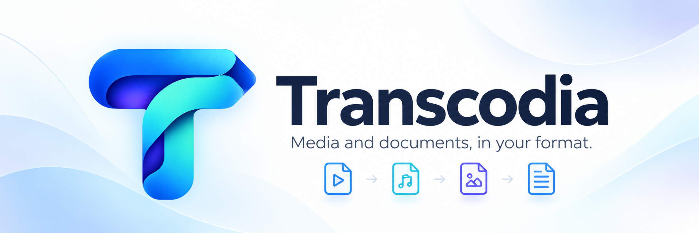
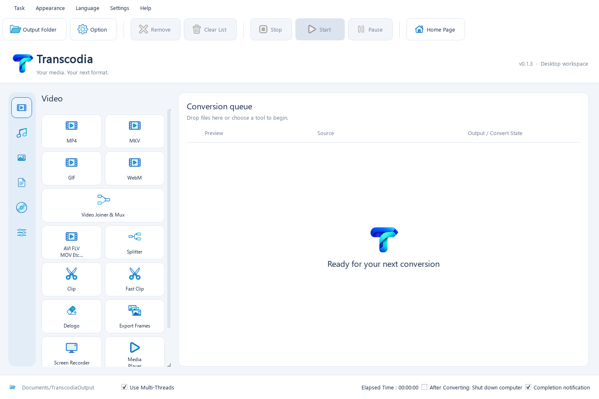
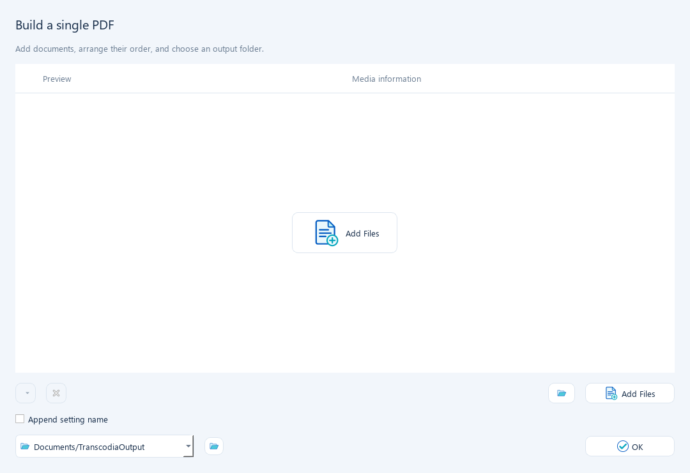
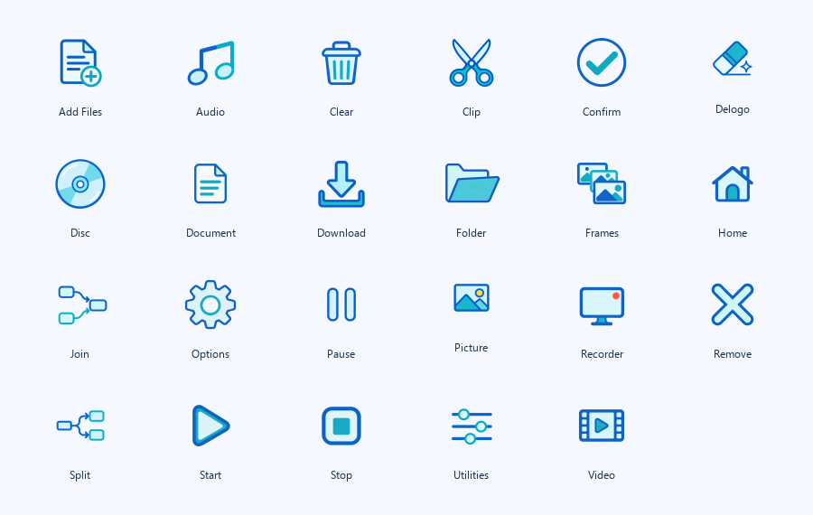

<p align="center">
  
</p>

<p align="center">
  <a href="https://github.com/mohammednabarawy/transcodia/actions/workflows/ci.yml"></a>
  
  
</p>

<p align="center">
  <a href="#features">Features</a> · <a href="#getting-started">Getting started</a> · <a href="#testing">Testing</a> · <a href="_docs/dev_setup.md">Developer guide</a> · <a href="ROADMAP.md">Roadmap</a>
</p>

# Transcodia

A focused desktop workspace for converting video, audio, images and documents. Choose a tool, configure the output, and manage the work in one queue. Files are processed locally.

Transcodia has its own visual identity: a dedicated navigation rail, a two-column tool library, a conversion workspace, five coordinated themes, and 23 generated interface icons. Arabic and English labels share the same workflow.



## Features

| Workspace | Capabilities |
| --- | --- |
| **Video** | Common containers and codecs, resize, rotate, crop, trim, delogo, deinterlace, stabilization, two-pass encoding, subtitles and watermarks |
| **Audio** | MP3, AAC, WAV, FLAC, WMA, M4A, OGG, M4R and AC3; volume, denoise, echo, fade and reverse |
| **Images** | Eight output formats, resizing, rotation, flipping, EXIF orientation and transparency handling |
| **Documents** | Merge PDFs; extract PDF content into TXT, HTML, Markdown, XLSX and DOCX; render DOCX text and tables to PDF |
| **Utilities** | Join media, mux replacement audio and subtitles, inspect media, export frames and split clips |
| **Queue** | Live progress, pause/resume, cancellation and retry, independent task settings, and saved task lists |

Hardware encoding depends on the installed encoder and device. Document conversion focuses on content rather than preserving every layout detail.

<details>
<summary>PDF workspace and interface artwork</summary>





The app mark, banner and interface icons were generated for this project using ChatGPT image generation. See the [asset creation record](_docs/asset_provenance.md).

</details>

## Getting started

### Run from source

Install Python 3.10 or later, then create an isolated environment and install the application dependencies:

```bash
git clone https://github.com/mohammednabarawy/transcodia.git
cd transcodia
python -m venv .venv
```

Activate the environment with `.venv\Scripts\Activate.ps1` on Windows or `source .venv/bin/activate` on macOS/Linux, then run:

```bash
python -m pip install -r requirements.txt
python main.py
```

The **Windows portable package includes FFmpeg, FFprobe and their required DLLs**. Extract the complete ZIP and run `Transcodia.exe`; no separate media-engine installation is needed. Running from source still requires FFmpeg on the development machine. Image and document tools use the declared Python libraries. See the [developer guide](_docs/dev_setup.md) for setup.

If a requested H.264 or HEVC hardware encoder fails, Transcodia retries once with the corresponding software encoder and shows a completion notice. The output codec, dimensions, audio, trims and filters are retained; hardware preset and quality controls are mapped to software settings. Software encoding can take longer. If both attempts fail, the task's error details include both failures.

### Build a desktop package

Install the development dependencies first:

```bash
python -m pip install -r requirements-dev.txt
```

| Platform | Build command |
| --- | --- |
| Windows | `./scripts/windows_build.ps1` |
| macOS / Linux | `bash scripts/unix_build.sh` |

Builds run regression tests, collect dependency notices, and verify real outputs from the packaged executable before creating an archive. Windows packages are unsigned; macOS signing is optional. Native macOS and Linux execution must be verified on their respective runners.

## Testing

```bash
python scripts/run_tests.py --coverage
```

The suite exercises actual Qt widgets, real media conversions, decoded output, image transformations, PDF merge order, document content, queue recovery, configuration persistence, and asset integrity. Reports are saved under `artifacts/tests/`.

See [TESTING.md](TESTING.md) for the current verification result and limits, and the [packaging report](_docs/packaging_verification.md) for distribution checks. Passing tests reduce regressions; they do not cover every possible file or hardware configuration.

## Project structure

```text
transcodia_app/       Desktop UI, handlers, generated artwork and localization
transcodia_engine/    Media task models, commands, filters and batch processing
scripts/             Tests, packaging, notices, versioning and source audits
packaging/           Desktop build specification and application icons
_docs/               Developer notes, asset provenance and current screenshots
.github/             Continuous integration and draft-release workflows
```

## Current limits

- The native player, screen recorder, downloader, disc and ISO tools are not implemented; their entry points report that status.
- PDF/DOCX conversion does not provide OCR or preserve complex source page layouts. DOCX-to-PDF uses a basic text/table renderer; complex scripts, embedded media and advanced styling require further work.
- Driver-specific hardware encoding, signing, notarization and every desktop DPI configuration are outside the automated verification result.

## Ownership and licenses

Original project material is reserved to **Mohammed Nabarawy**, subject to the rights he holds and applicable law. See [LICENSE](LICENSE). Public source visibility is not an open-source license grant.

Dependencies remain owned by their respective authors. Their notices and license obligations are preserved in [THIRD_PARTY_NOTICES.md](THIRD_PARTY_NOTICES.md) and in each build's dependency notice inventory. The project makes no claim that third-party libraries or newly generated artwork are exempt from copyright, licensing or trademark review.
